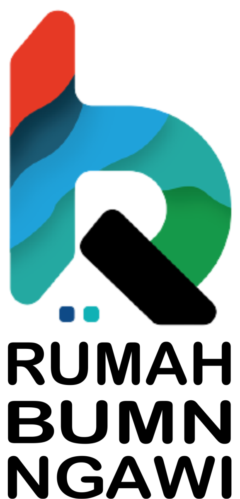
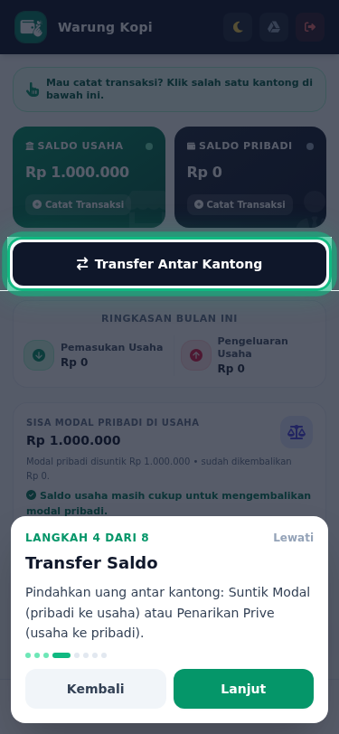
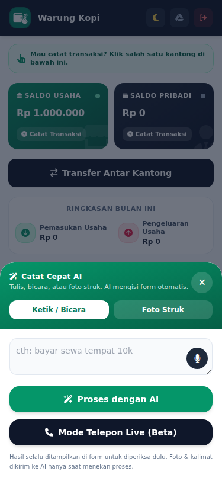
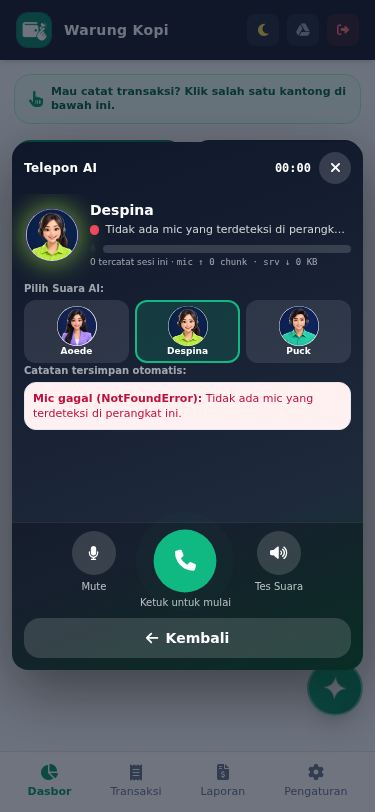

  
  <h1>DompetKu</h1>
  
<strong>Aplikasi Pencatatan Keuangan UMKM Terintegrasi Kecerdasan Buatan</strong>

  

    
    
    
    
    
  

  

    
    
  

 

---

## Deskripsi Aplikasi

DompetKu adalah aplikasi pencatatan keuangan berbasis web (Progressive Web App/PWA) yang dirancang untuk membantu UMKM mengelola keuangan usaha dan pribadi secara praktis, terstruktur, dan efisien. Mengusung arsitektur offline-first dengan penyimpanan lokal menggunakan IndexedDB serta fitur backup & restore melalui Google Drive pengguna, DompetKu dapat digunakan tanpa ketergantungan pada server berbayar. Aplikasi ini mengintegrasikan teknologi Artificial Intelligence (AI) untuk pencatatan transaksi melalui input teks bahasa sehari-hari, pemindaian foto struk belanja, dan interaksi suara secara real-time melalui fitur Telepon Live. AI secara otomatis memahami informasi transaksi, menentukan kantong Usaha atau Pribadi, mengklasifikasikan Pemasukan atau Pengeluaran, serta mengekstraksi detail transaksi. Dilengkapi pengelolaan kategori, transfer Suntik Modal/Prive, laporan laba bersih dan prive dalam bentuk grafik dan tabel, serta ekspor data CSV/JSON. DompetKu dikembangkan sebagai inovasi digital dalam mendukung digitalisasi dan peningkatan literasi keuangan UMKM melalui Program Magang Berdampak 2026 Universitas Negeri Surabaya bersama Rumah BUMN BNI Ngawi.

---

## Tentang Proyek

Proyek aplikasi **DompetKu** dikembangkan dalam rangka Program Magang Berdampak oleh mahasiswa Program Studi S1 Pendidikan Teknologi Informasi, Universitas Negeri Surabaya bekerja sama dengan Rumah BUMN BNI Ngawi.

| Informasi | Keterangan |
| :--- | :--- |
| **Nama Pengembang** | Fazrin Mauza Dwi Zuhudi |
| **NIM** | 24050974090 |
| **Program Studi** | S1 Pendidikan Teknologi Informasi |
| **Fakultas** | Fakultas Teknik |
| **Perguruan Tinggi** | Universitas Negeri Surabaya |
| **Mitra Instansi** | Rumah BUMN BNI Ngawi |
| **Program** | Program Magang Berdampak Semester Gasal 2026/2027 |
| **Waktu Pelaksanaan** | 03 Agustus 2026 – 03 Desember 2026 |

---

## Fitur Utama Kecerdasan Buatan (AI)

DompetKu mengintegrasikan teknologi AI untuk mempermudah dan mempercepat proses input transaksi tanpa pengisian formulir manual yang rumit:

1. **Pemindaian Foto Struk**
   Pengguna cukup mengunggah atau memotret struk belanja, nota, atau tagihan. AI secara otomatis mengekstraksi nilai transaksi, tanggal, serta mengklasifikasikan kategori transaksi dan menyimpannya bersama lampiran foto bukti transaksi.

2. **Input Teks Bahasa Alami**
   Pencatatan transaksi dapat dilakukan layaknya berkirim pesan singkat. AI mengenali konteks bahasa sehari-hari (contoh: *"Beli bahan baku kue 150 ribu uang usaha"*), lalu memetakan nominal, kategori, jenis arus kas, dan kantong yang sesuai secara otomatis.

3. **Telepon Live (Voice AI)**
   Interaksi suara dua arah secara real-time yang memungkinkan pengguna mencatat keuangan secara verbal layaknya berkomunikasi langsung dengan asisten pribadi.

---

## Fitur Fungsional Keuangan & Sistem

- **Pemisahan Kantong Usaha & Pribadi:** Memisahkan catatan dan saldo kas usaha dari kas pribadi untuk mencegah percampuran dana bisnis dan rumah tangga.
- **Manajemen Modal & Prive:** Mendukung pencatatan transfer antar-kantong melalui mekanisme Suntik Modal (pribadi ke usaha) dan Prive (penarikan dana usaha untuk keperluan pribadi).
- **Arsitektur Local-First (Offline-First):** Seluruh data disimpan langsung pada perangkat pengguna menggunakan IndexedDB, sehingga aplikasi dapat berjalan lancar tanpa ketergantungan koneksi internet konstan.
- **Pencadangan Mandiri Google Drive:** Fasilitas *backup and restore* data secara aman langsung ke akun Google Drive pribadi pengguna tanpa pihak ketiga.
- **Laporan & Analitik Keuangan:** Visualisasi grafik dan tabel komprehensif untuk memantau laba bersih, akumulasi prive, tren arus kas, serta rekapitulasi berkala.
- **Ekspor Data:** Dukungan unduh data transaksi dalam format CSV dan JSON untuk dokumentasi, pembukuan lanjutan, atau arsip mandiri.

---

## Tampilan Antarmuka

Aplikasi DompetKu dirancang dengan antarmuka yang bersih, responsif, dan adaptif untuk perangkat seluler maupun desktop (Mobile-First Responsive Design).

### Dashboard Utama & Manajemen Transaksi

  

 

### Fitur AI: Input Cerdas & Telepon Live

  
  

 

---

  
Dikembangkan oleh <strong>Fazrin Mauza Dwi Zuhudi</strong> Program Magang Berdampak 2026 — Universitas Negeri Surabaya & Rumah BUMN BNI Ngawi

