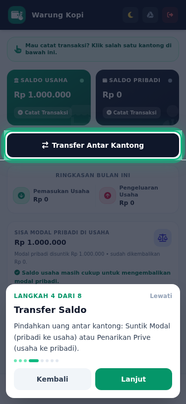
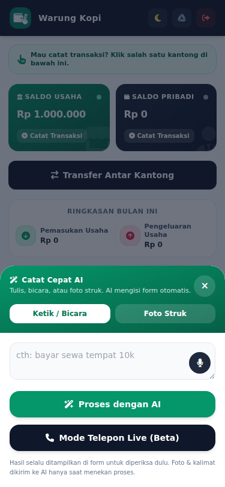
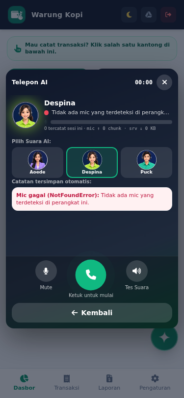

  
  <h1>DompetKu</h1>
  
<strong>Aplikasi Pencatatan Keuangan Usaha & Pribadi Cerdas</strong>

  

    
    
  

 

---

## 👨‍🎓 Tentang Proyek Ini

Proyek aplikasi **DompetKu** ini dikembangkan sebagai bagian dari tugas akhir Program Magang Mahasiswa.

*   **Nama:** Fazrin Mauza Dwi Zuhudi
*   **NIM:** 24050974090
*   **Program Studi:** S1 Pendidikan Teknologi Informasi
*   **Fakultas:** Fakultas Teknik
*   **Universitas:** Universitas Negeri Surabaya
*   **Periode Magang:** Semester Gasal 2026/2027
*   **Lokasi Magang:** Rumah BUMN BNI Ngawi
*   **Waktu Pelaksanaan:** 03 Agustus 2026 - 03 Desember 2026

---

## 📱 Tampilan Aplikasi

Aplikasi DompetKu dirancang dengan antarmuka yang bersih, responsif, dan mudah digunakan, khusus dioptimalkan untuk perangkat mobile (Mobile-First Design).

### Dashboard Utama & Manajemen Profil

  

 

---

## ✨ Fitur Unggulan AI (Kecerdasan Buatan)

DompetKu dilengkapi dengan asisten cerdas (AI) yang membuat pencatatan keuangan menjadi sangat praktis dan cepat, tanpa harus repot mengisi form secara manual.

  
  

### 1. 📸 Foto Struk AI
Tidak perlu mengetik satu-satu lagi! Cukup foto struk belanja, nota, atau tagihan Anda. AI akan secara otomatis membaca teks pada gambar, mengenali total harga, dan mengkategorikan transaksi tersebut (misalnya: Pemasukan atau Pengeluaran).

### 2. 📝 Teks Perintah Cepat
Catat keuangan seperti mengirim pesan. Ketik kalimat sederhana seperti *"Beli kopi 20 ribu pakai uang pribadi"* atau *"Dapat bayaran proyek 500 ribu masuk usaha"*, dan AI akan langsung mengubahnya menjadi entri transaksi yang rapi sesuai nominal dan kantong yang tepat.

### 3. 📞 Live Telpon Asisten (Voice AI)
Fitur eksklusif masa depan! Anda dapat melakukan "panggilan telepon" dengan asisten virtual DompetKu. Cukup berbicara layaknya menelpon asisten pribadi Anda, ucapkan transaksi yang ingin dicatat, dan asisten akan mencatatkannya untuk Anda secara *real-time*.

---

## 🛠️ Fitur Lainnya

*   **Pemisahan Kantong:** Kelola saldo Usaha dan Pribadi secara terpisah namun dalam satu aplikasi.
*   **Pencatatan Offline:** Bisa mencatat transaksi meskipun sedang tidak ada koneksi internet.
*   **Laporan Otomatis:** Menghasilkan laporan harian dan bulanan yang bisa diekspor ke PDF dan CSV.
*   **Integrasi Google Drive:** Cadangkan data Anda dengan aman ke akun Google Drive pribadi.

 

  
Dibuat dengan ❤️ oleh Fazrin Mauza Dwi Zuhudi

