

  
  <h1>DompetKu</h1>
  
<strong>Aplikasi Pencatatan Keuangan UMKM Terintegrasi Kecerdasan Buatan</strong>

  

    
    
    
    
    
  

  

    
    
  

 

---

## Deskripsi Aplikasi

DompetKu adalah aplikasi pencatatan keuangan berbasis web (Progressive Web App/PWA) yang dirancang untuk membantu UMKM mengelola keuangan usaha dan pribadi secara praktis, terstruktur, dan efisien. Mengusung arsitektur offline-first dengan penyimpanan lokal menggunakan IndexedDB serta fitur backup & restore melalui Google Drive pengguna, DompetKu dapat digunakan tanpa ketergantungan pada server berbayar. Aplikasi ini mengintegrasikan teknologi Artificial Intelligence (AI) untuk pencatatan transaksi melalui input teks bahasa sehari-hari, pemindaian foto struk belanja, dan interaksi suara secara real-time melalui fitur Telepon Live. AI secara otomatis memahami informasi transaksi, menentukan kantong Usaha atau Pribadi, mengklasifikasikan Pemasukan atau Pengeluaran, serta mengekstraksi detail transaksi. Dilengkapi pengelolaan kategori, transfer Suntik Modal/Prive, laporan laba bersih dan prive dalam bentuk grafik dan tabel, serta ekspor data CSV/JSON. DompetKu dikembangkan sebagai inovasi digital dalam mendukung digitalisasi dan peningkatan literasi keuangan UMKM melalui Program Magang Berdampak 2026 Universitas Negeri Surabaya bersama Rumah BUMN BNI Ngawi.

---

## Informasi Pengembangan

| Parameter | Keterangan |
| :--- | :--- |
| **Nama Pengembang** | Fazrin Mauza Dwi Zuhudi |
| **NIM** | 24050974090 |
| **Program Studi** | S1 Pendidikan Teknologi Informasi |
| **Fakultas** | Fakultas Teknik |
| **Perguruan Tinggi** | Universitas Negeri Surabaya |
| **Mitra Instansi** | Rumah BUMN BNI Ngawi |
| **Program** | Program Magang Berdampak Semester Gasal 2026/2027 |
| **Periode Pelaksanaan** | 03 Agustus 2026 sampai dengan 03 Desember 2026 |

---

## Arsitektur dan Landasan Teknis

Sistem dikembangkan dengan berlandaskan pada prinsip rekayasa perangkat lunak untuk menjamin skalabilitas, efisiensi operasional, dan kepatuhan privasi data pengguna:

1. **Penyimpanan Lokal Mandiri (Local-First Architecture)**
   Seluruh data transaksi dan entitas finansial disimpan langsung pada basis data lokal peramban klien menggunakan IndexedDB. Pendekatan ini mengeliminasi ketergantungan pada basis data peladen terpusat yang berbayar serta menjamin fungsionalitas penuh saat perangkat berada dalam kondisi luring (offline).

2. **Sinkronisasi Terdesentralisasi Google Drive**
   Untuk mitigasi risiko kehilangan data lokal, sistem mengimplementasikan mekanisme pencadangan dan pemulihan data mandiri langsung ke media penyimpanan awan Google Drive milik pengguna melalui protokol OAuth 2.0 tanpa perantara pihak ketiga.

3. **Pemisahan Entitas Keuangan Usaha dan Pribadi**
   Mengadopsi prinsip akuntansi dasar UMKM dengan memisahkan kas operasional usaha dari kas konsumtif pribadi. Aliran kas antar-kantong dicatat melalui mekanisme penambahan modal (Suntik Modal) dan penarikan ekuitas pemilik (Prive).

4. **Pemrosesan Kecerdasan Buatan Multi-Modal**
   Pemanfaatan antarmuka pemrograman aplikasi Google Gemini memungkinkan konversi data tidak terstruktur (teks percakapan bebas, berkas citra nota, dan masukan suara) menjadi entri transaksi terstruktur secara otomatis.

---

## Implementasi Antarmuka Pengguna

Pengembangan antarmuka pengguna mengadopsi pendekatan Mobile-First Responsive Design untuk menjamin kemudahan interaksi pada perangkat seluler. Pengujian fungsionalitas sistem mencakup 13 tampilan antarmuka utama yang dikelompokkan ke dalam 5 modul operasional sebagai berikut:

### 1. Inisialisasi dan Konfigurasi Profil

<table>
  <tr>
    <td width="33%" align="center" valign="top">
      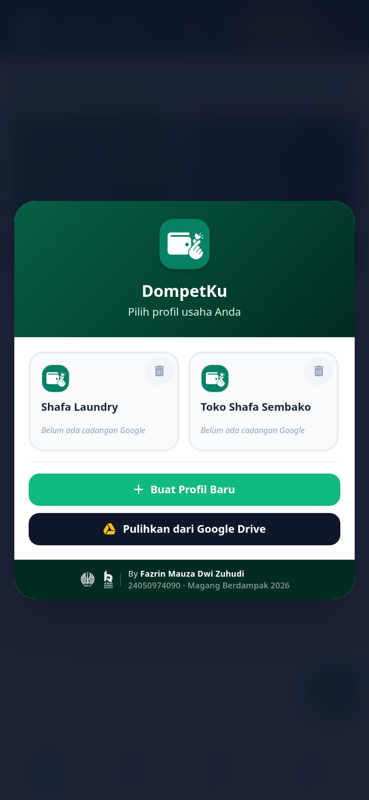
        <strong>Gambar 1.</strong> Pemilihan Profil Kas (Entitas Usaha dan Pribadi)
    </td>
    <td width="33%" align="center" valign="top">
      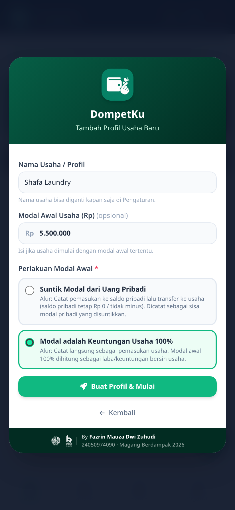
        <strong>Gambar 2.</strong> Formulir Registrasi Entitas Usaha
    </td>
    <td width="33%" align="center" valign="top">
      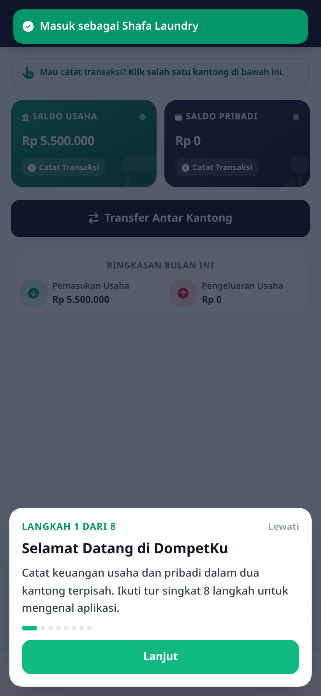
        <strong>Gambar 3.</strong> Panduan Orientasi Fitur Aplikasi
    </td>
  </tr>
</table>

### 2. Manajemen Transaksi dan Alur Kas

<table>
  <tr>
    <td width="50%" align="center" valign="top">
      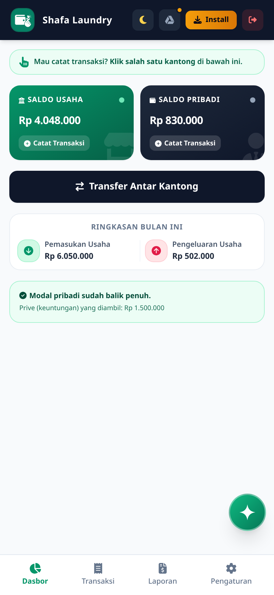
        <strong>Gambar 4.</strong> Dasbor Utama Saldo dan Arus Kas
    </td>
    <td width="50%" align="center" valign="top">
      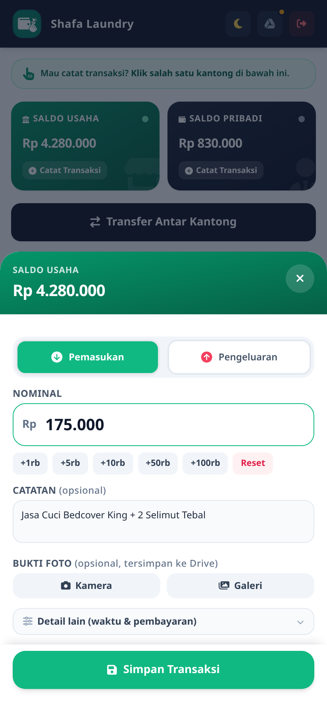
        <strong>Gambar 5.</strong> Formulir Pencatatan Transaksi Kas Usaha
    </td>
  </tr>
  <tr>
    <td width="50%" align="center" valign="top">
      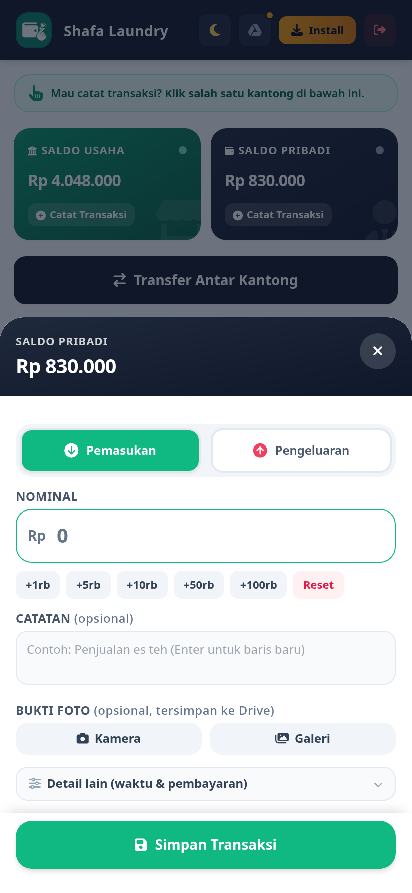
        <strong>Gambar 6.</strong> Formulir Pencatatan Transaksi Kas Pribadi
    </td>
    <td width="50%" align="center" valign="top">
      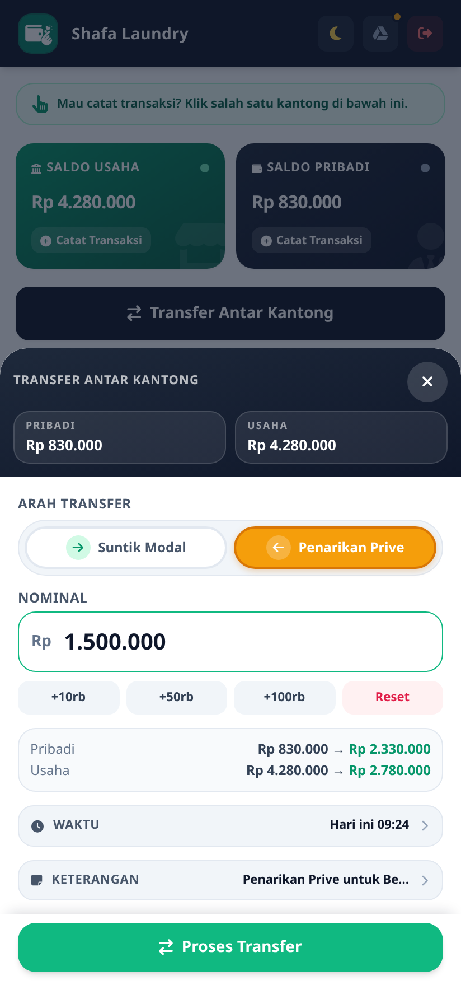
        <strong>Gambar 7.</strong> Formulir Transfer Modal dan Penarikan Prive
    </td>
  </tr>
</table>

### 3. Monitoring Riwayat dan Laporan Finansial

<table>
  <tr>
    <td width="50%" align="center" valign="top">
      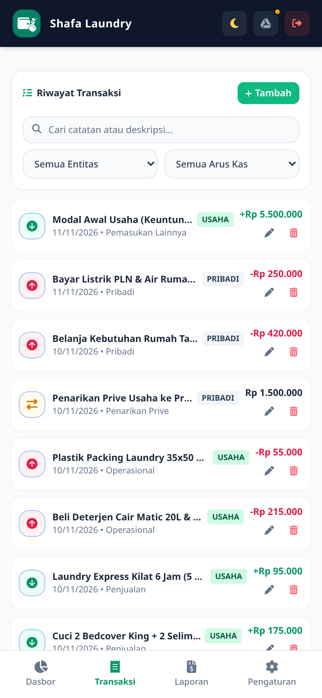
        <strong>Gambar 8.</strong> Riwayat Mutasi dan Log Transaksi Terinci
    </td>
    <td width="50%" align="center" valign="top">
      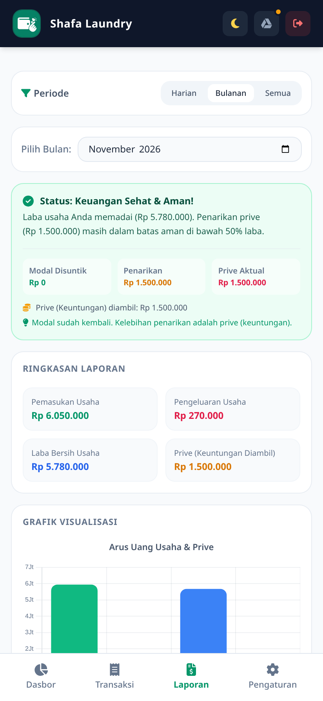
        <strong>Gambar 9.</strong> Rekapitulasi Laba Bersih dan Grafik Keuangan
    </td>
  </tr>
</table>

### 4. Otomasi Berbasis Kecerdasan Buatan (AI)

<table>
  <tr>
    <td width="33%" align="center" valign="top">
      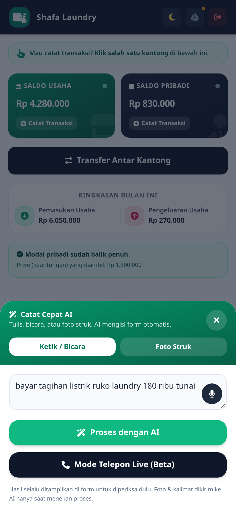
        <strong>Gambar 10.</strong> Ekstraksi Transaksi melalui Bahasa Alami (NLP)
    </td>
    <td width="33%" align="center" valign="top">
      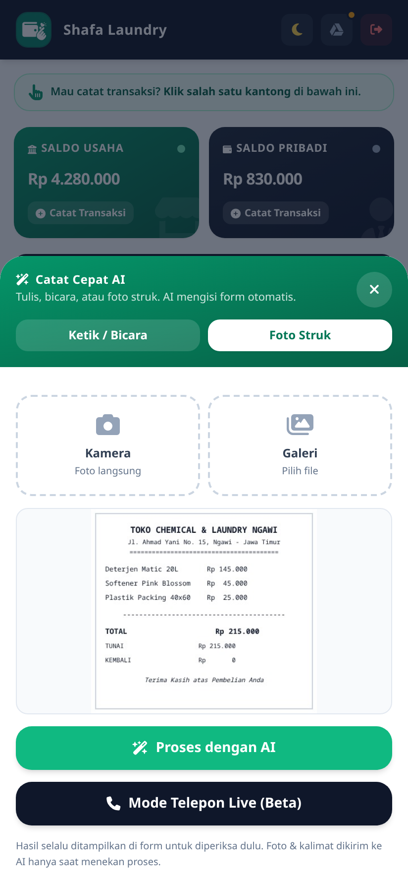
        <strong>Gambar 11.</strong> Pemindaian Bukti Fisik Struk Belanja (Vision AI)
    </td>
    <td width="33%" align="center" valign="top">
      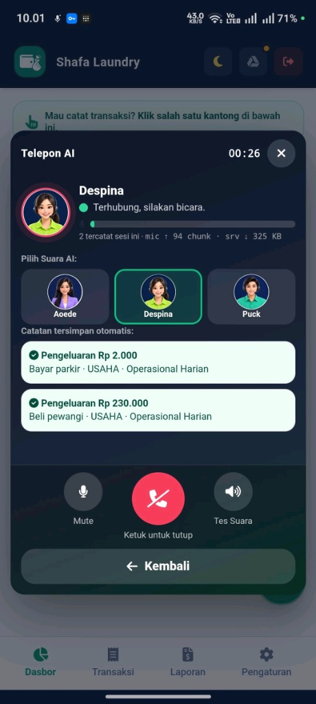
        <strong>Gambar 12.</strong> Interaksi Panggilan Suara Dua Arah (Telepon Live)
    </td>
  </tr>
</table>

### 5. Konfigurasi Sistem dan Keamanan Data

<table>
  <tr>
    <td width="100%" align="center" valign="top">
      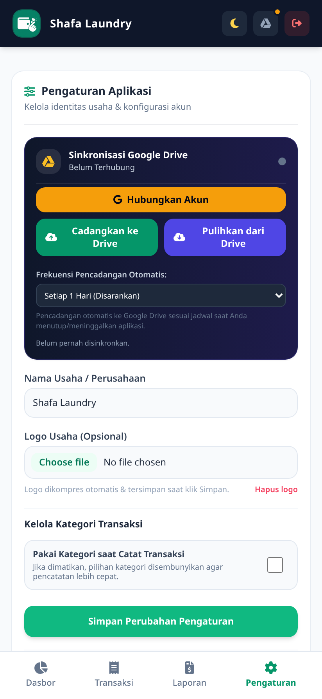
        <strong>Gambar 13.</strong> Konfigurasi Sistem, Kategori, dan Cadangan Google Drive
    </td>
  </tr>
</table>

---

## Analisis Fungsional Antarmuka

Berikut merupakan deskripsi teknis dari setiap komponen antarmuka yang diimplementasikan pada sistem:

### 1. Inisialisasi dan Konfigurasi Pengguna (Gambar 1, Gambar 2, Gambar 3)
- **Pemilihan Profil Kas (Gambar 1):** Berfungsi sebagai gerbang pemisah antara pembukuan usaha mikro dan pengelolaan keuangan personal. Pengguna dapat berganti konteks secara terisolasi tanpa mencampuradukkan saldo rekening.
- **Registrasi Profil Usaha (Gambar 2):** Menampung data legalitas dan identitas usaha, seperti nama usaha, sektor usaha, saldo kas awal, serta preferensi dasar pembukuan.
- **Panduan Pengenalan Sistem (Gambar 3):** Modul interaktif terpadu yang memandu pengguna baru dalam memahami tata cara operasional pencatatan, pemisahan kantong kas, serta pemanfaatan fitur automasi.

### 2. Manajemen Transaksi dan Mutasi Kas (Gambar 4, Gambar 5, Gambar 6, Gambar 7)
- **Dasbor Utama (Gambar 4):** Menampilkan ringkasan total saldo kas usaha aktif, saldo kas pribadi, total akumulasi pemasukan dan pengeluaran bulan berjalan, serta pintasan cepat menuju modul pencatatan.
- **Pencatatan Transaksi Kas Usaha (Gambar 5):** Formulir pencatatan operasional bisnis untuk merekam kas masuk maupun kas keluar yang terikat langsung pada pos akun usaha, lengkap dengan klasifikasi kategori beban atau omzet, metode pembayaran, tanggal transaksi, dan keterangan transaksi.
- **Pencatatan Transaksi Kas Pribadi (Gambar 6):** Formulir pencatatan kebutuhan personal yang terisolasi dari pembukuan bisnis, memastikan pencatatan pengeluaran konsumtif dan pendapatan non-usaha tidak mendistorsi perhitungan laba bersih usaha.
- **Transfer Modal dan Penarikan Prive (Gambar 7):** Fasilitas pencatatan mutasi internal antara kas usaha dan kas pribadi, mencakup transfer Suntik Modal (penambahan modal dari dana pribadi ke kas usaha) dan Prive (penarikan kas usaha untuk kebutuhan pribadi), sehingga akurasi perhitungan laba bersih usaha dan posisi kas riil tetap terjaga.

### 3. Pemantauan Riwayat dan Pelaporan (Gambar 8, Gambar 9)
- **Riwayat Mutasi Transaksi (Gambar 8):** Modul penelusuran seluruh catatan transaksi historis yang dilengkapi fitur penyaringan berdasarkan rentang tanggal, jenis arus kas, kategori transaksi, maupun kata kunci pencarian.
- **Laporan dan Analitik Keuangan (Gambar 9):** Penyajian rekapitulasi kinerja finansial berbasis periode tertentu. Menghitung secara otomatis selisih pendapatan dan beban operasional untuk menghasilkan laba atau rugi bersih, disertai visualisasi grafik tren yang dapat diekspor ke dalam format CSV dan JSON.

### 4. Otomasi Berbasis Kecerdasan Buatan (Gambar 10, Gambar 11, Gambar 12)
- **Pencatatan Bahasa Alami / NLP (Gambar 10):** Memfasilitasi pengguna untuk memasukkan keterangan transaksi dalam bahasa percakapan sehari-hari. Model AI mengekstraksi nominal, entitas kantong, jenis arus kas, serta klasifikasi kategori transaksi secara otomatis tanpa pengisian formulir manual.
- **Pemindaian Bukti Fisik Struk (Gambar 11):** Fitur pemrosesan citra nota atau struk belanja menggunakan Optical Character Recognition (OCR) dan penalaran multimodal untuk mendeteksi tanggal transaksi, nama rekanan dagang, dan total nominal tagihan secara tepat.
- **Panggilan Suara Real-Time Telepon Live (Gambar 12):** Antarmuka interaksi suara dua arah yang memproses masukan audio pengguna secara langsung, mengekstraksi data finansial yang dibicarakan, dan mencatatkannya ke dalam sistem pembukuan secara langsung.

### 5. Konfigurasi Sistem dan Keamanan Data (Gambar 13)
- **Pengaturan Preferensi dan Sinkronisasi (Gambar 13):** Fasilitas untuk mengatur hierarki kategori transaksi kustom, mengelola autentikasi Google Drive untuk keperluan pencadangan (backup) dan pemulihan (restore) berkas basis data, serta mengelola preferensi operasional aplikasi.

---

  
Dikembangkan oleh <strong>Fazrin Mauza Dwi Zuhudi</strong> (NIM: 24050974090) Program Magang Berdampak 2026: Universitas Negeri Surabaya dan Rumah BUMN BNI Ngawi

